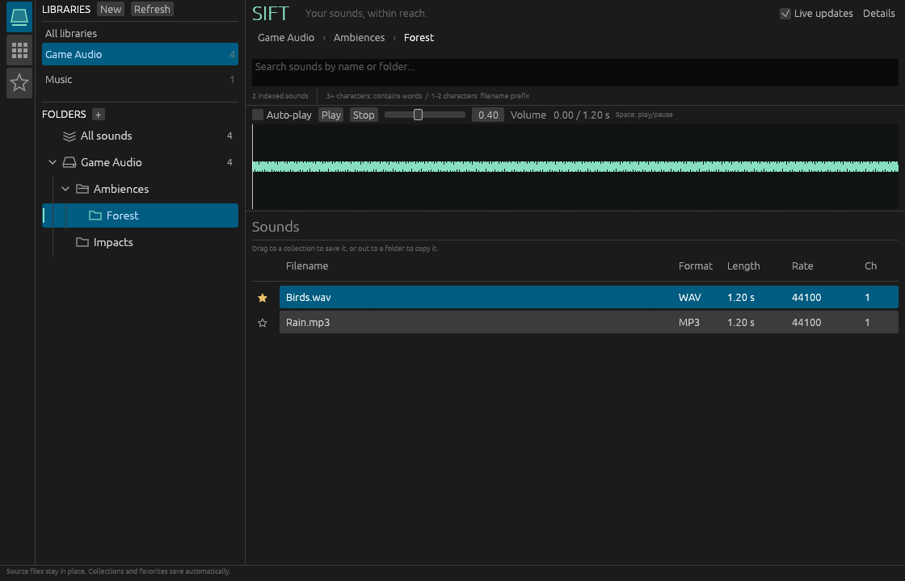

# Sift

<picture>
  <source media="(prefers-color-scheme: dark)" srcset="assets/brand/sift-logo-white.svg">
  
</picture>

A local sample browser for sound effects, samples, and music. Find a sound,
preview it, save a reference in a collection, and drag a copy into your workflow.

Sift is a Windows prototype written in Rust. It works offline and prioritizes
responsive browsing, bounded memory, and preserving original audio files.



## Features

- Named libraries with multiple source folders and a hierarchical folder browser.
- Filename and path search with paged results.
- Waveform preview, playback, seeking, volume, and auto-play.
- Collections and global favorites that survive rebuilding the search index.
- Incremental indexing and automatic detection of Windows folder changes.
- Copy-only file dragging to Explorer.

## Getting started

Install Rust with rustup and the Visual Studio C++ build tools on Windows.
The repository pins the Rust toolchain and tracks Cargo.lock.

```powershell
cargo run --locked
```

Create a library with **New**, then use **Folders +** to add a source folder.
Click a folder name to browse its sounds; the chevron opens its subfolders.
**All sounds** restores the library scope, and **Ctrl+F** focuses search.

Click a sound to inspect its waveform. Play/Pause, Space, Stop, volume, waveform
clicking, and **Auto-play** control the preview. Star a sound to save it in
**Favorites**. **Collections +** creates a saved selection; **Add selected sound**
or an internal drag adds a reference. Changes save automatically.

To copy a sound, drag its row out to an Explorer folder. Escape cancels. Explorer
handles destination conflicts and copying progress. Original files stay in place.

**Live updates** watches registered folders. Pause with the checkbox; resuming
checks for changes made while paused. **Details** opens the metadata panel.

### Command line

```powershell
cargo run --locked -- index "C:\path\to\samples"
cargo run --locked -- search "door wood"
cargo run --locked -- search "door" --offset 128
```

Use `--database PATH` for isolated experiments. The Windows default is
`%LOCALAPPDATA%\Sift\catalog.sqlite`. Library registrations live in
`catalog.libraries.sqlite`; collections and favorites share
`catalog.collections.sqlite`. Durable user data is separate from rebuildable indexes.

## Current scope

The index recognizes WAV, FLAC, MP3, and AIFF. Verified container metadata does
not guarantee support for every codec or audio device. Source errors remain
visible, and offline libraries retain cached records and saved references.

Selection is currently single-item. Collection folders, item ordering, tags,
application-managed export, and automatic relinking of moved saved sources are
future work. Similarity search is optional later work.

Performance measurements use generated fixtures with documented limits.
Representative large libraries, external drives, NAS, and the broader device
matrix still need qualification.

## Development

```powershell
cargo fmt --all -- --check
cargo test --locked
cargo clippy --locked --all-targets -- -D warnings
```

The CLI-only configuration is available with `--no-default-features`.
Private libraries, databases, exports, build output, and local working notes are
excluded from version control.

## Documentation

- [Architecture](docs/ARCHITECTURE.md): storage, threads, and native boundaries.
- [Product requirements](docs/PRODUCT.md): behavior and data-preservation rules.
- [Libraries](docs/LIBRARIES.md), [Collections](docs/COLLECTIONS.md), and
  [Favorites](docs/FAVORITES.md): browser and saved-reference workflows.
- [Indexing](docs/INDEXING.md): incremental scanning and live file updates.
- [Preview](docs/PREVIEW.md) and [file dragging](docs/DRAG-AND-DROP.md): audio and transfer behavior.
- [Performance](docs/PERFORMANCE.md) and [index measurements](docs/INDEXING-BASELINE.md): methods, results, and limits.
